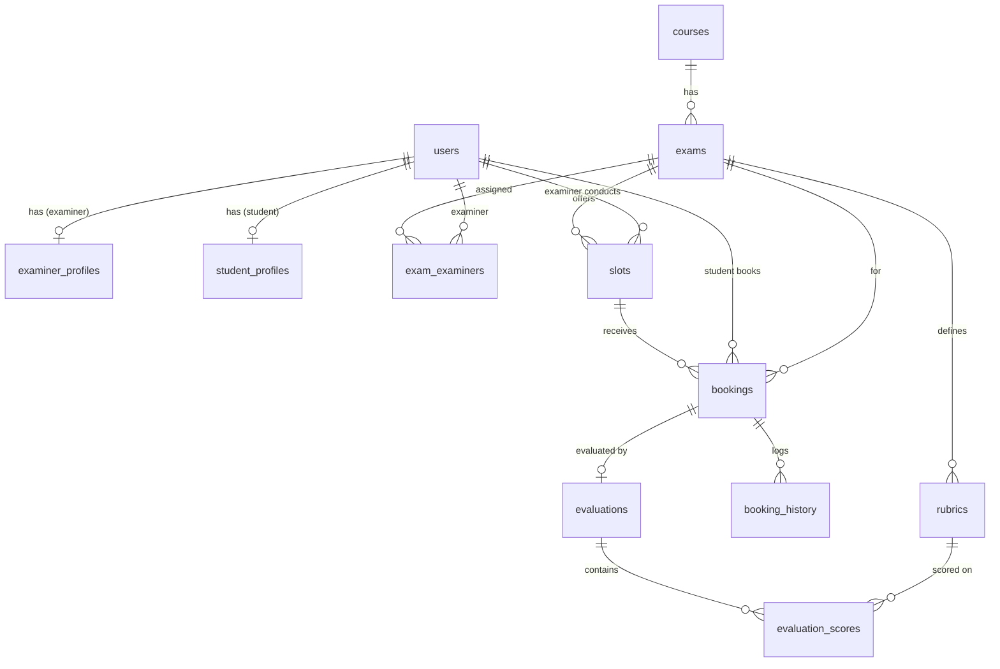

# Examination Management Portal (EMP)

Role-based web app for Admins, Examiners and Students to manage examination schedules, slot creation, slot booking, rubric-based evaluation and results.

**Stack:** Flask (backend) · Jinja2 + HTML + Bootstrap 5 (frontend) · SQLite (database, created from code).
No JavaScript is used for any core feature (Bootstrap's own JS is loaded only for the navbar toggle and dismissing alerts).

## Run it

```bash
pip install flask            # the only dependency (see requirements.txt)
python app.py                # http://127.0.0.1:5000
```

The SQLite file `instance/emp.db` and all tables are created programmatically on first start (`db.init_db`), together with the pre-existing Admin account:

| Role  | Login             | Password   |
|-------|-------------------|------------|
| Admin | admin@emp.local   | admin123   |

(Override with the `EMP_ADMIN_EMAIL`, `EMP_ADMIN_PASSWORD` and `EMP_SECRET_KEY` environment variables.)

Optional demo data: `python seed_demo.py` (demo password `demo123`; see the script output for the logins).
Self-check: `python smoke_test.py` (runs ~58 checks on a throw-away database).

Bootstrap is loaded from the jsDelivr CDN, so the first page load needs internet access. For a fully offline demo, download `bootstrap.min.css` into `static/` and change the `<link>` in `templates/base.html`.

## Folder structure

```
app.py            application factory, CSRF check, error pages
db.py             schema (CREATE TABLE ...), connection + transaction helper, admin bootstrap
utils.py          RuleError, date/time validation, slot seat bookkeeping, clash checks, scoring
auth.py           login, register (student / examiner), approval-pending page, profile, role guard
admin.py          Admin blueprint      examiner.py   Examiner blueprint
student.py        Student blueprint    api.py        read-only JSON API
templates/        base, _macros, auth/, admin/, examiner/, student/
static/style.css
seed_demo.py, smoke_test.py, requirements.txt
```

## Workflow

1. **Admin** creates a course and an examination (type, duration, max marks, four timeline dates), adds **rubric** criteria, and assigns approved examiners.
2. Admin approves examiners who registered, then **opens slot creation** → exam status `Slot Creation`.
3. **Examiners** create slots (date, time, capacity). Admin **closes slot creation** (`Draft`) and **opens booking** → `Booking Open`.
4. **Students** book a slot; seats drop, the slot turns `Full` at capacity; they can cancel until the booking deadline.
5. Examiners **evaluate** each booked student against the rubric and add remarks; the booking becomes `Completed`.
6. Admin **publishes results**; students see marks, rubric breakdown, remarks and can download a scorecard.

Exam status meaning: `Draft` = no phase open · `Slot Creation` · `Booking Open` · `Closed` · `Completed`.

## Business rules enforced (server-side)

- Slots can be created only while the exam is in `Slot Creation` **and** today is inside the slot-creation dates.
- Slots can be edited/removed only before booking starts and while nobody has booked them.
- Students can book only while `Booking Open` **and** inside the booking dates.
- No overbooking: every booking/cancel/reschedule runs inside a `BEGIN IMMEDIATE` transaction and seats are recomputed from live bookings. A full slot closes automatically and re-opens when a seat frees up.
- One live booking per student per examination (also a partial unique index in the DB); a student cannot hold two overlapping slots; an examiner cannot create overlapping slots.
- Cancellation allowed only while status is `Booked` and the booking deadline has not passed.
- Examiners can evaluate only students booked into **their own** slots; marks are capped at each criterion maximum and locked once results are published.
- Complete booking history is stored in `booking_history` (booked / cancelled / rescheduled / examiner changed / evaluated) and is never deleted.
- Admin can reschedule a booking to another slot of the same exam and change a slot's examiner.
- Passwords are hashed (Werkzeug), every POST carries a CSRF token, and unapproved examiners cannot reach the dashboard.

**Marks:** final marks = Σ (marks_i / max_i × weightage_i) / Σ weightage × exam max marks. If all weightages are 0 it falls back to total marks ÷ total criterion maximum.

## ER diagram



| Table | Key columns |
|---|---|
| users | id, role (admin/examiner/student), name, email (unique), password_hash, contact |
| examiner_profiles | user_id (PK/FK), department, designation, status (Pending/Approved/Deactivated) |
| student_profiles | user_id (PK/FK), roll_no (unique), program |
| courses | id, code (unique), name, description, credits, status |
| exams | id, course_id, name, exam_type, duration_minutes, max_marks, slot_create_start/end, book_start/end, status, results_published, venue, instructions |
| exam_examiners | exam_id, examiner_id (composite PK) |
| rubrics | id, exam_id, criterion, max_marks, weightage, description |
| slots | id, exam_id, examiner_id, slot_date, start_time, end_time, capacity, available_seats, status, venue |
| bookings | id, student_id, slot_id, exam_id, booked_at, status, cancelled_at |
| booking_history | id, booking_id, student_id, action, detail, created_at |
| evaluations | id, booking_id (unique), examiner_id, total_marks, remarks, evaluated_at |
| evaluation_scores | evaluation_id, rubric_id (composite PK), marks |

## API (read-only JSON, requires a logged-in session)

| Endpoint | Access |
|---|---|
| `GET /api/exams` | all roles (students: non-draft only) |
| `GET /api/exams/<id>` | all roles, includes rubrics |
| `GET /api/slots?exam_id=` | all roles (examiners: own slots) |
| `GET /api/bookings` | admin: all · examiner: own slots · student: own |
| `GET /api/examiners` | admin only |
| `GET /api/students` | admin only |

Unauthenticated calls return `401`, wrong role returns `403`.

## Report reminder

Your submission needs a ≤5-page report (student details, problem approach, **AI/LLM declaration**, frameworks used, the ER diagram above, API endpoints, video link). Be ready to explain and modify any part of this code in the viva.
